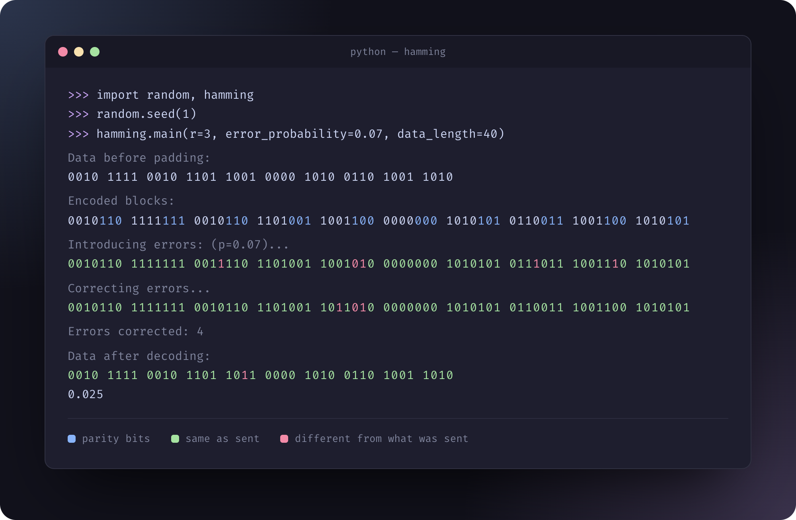
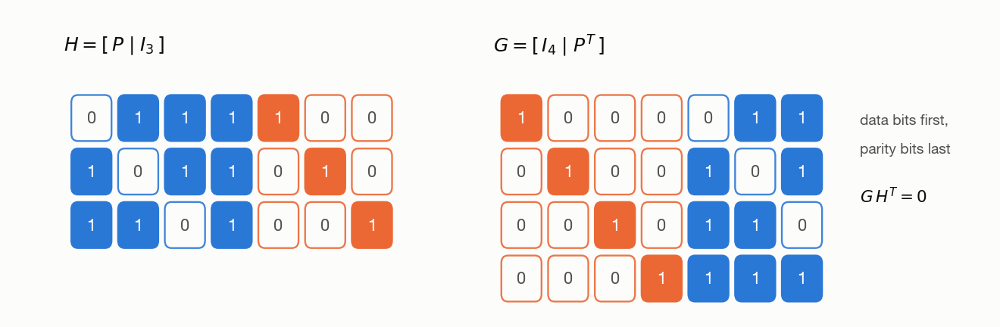
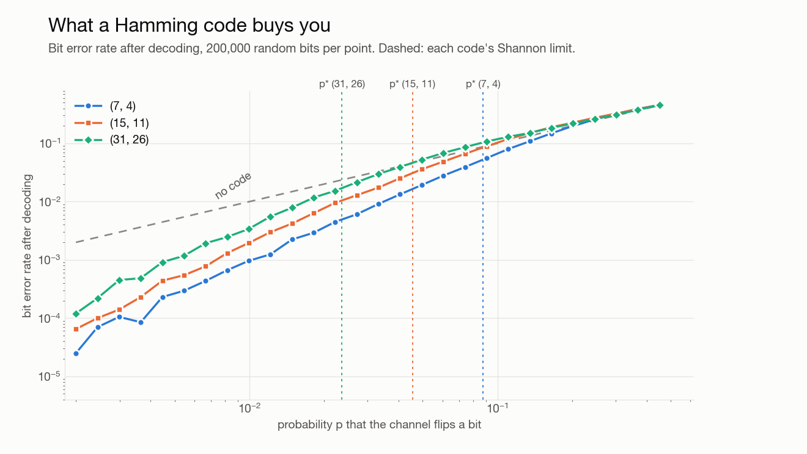

<div align="center">

# Hamming Code

**Single-error-correcting codes, built from their parity-check matrix and sent through a noisy channel.**<br>
Information Theory and Coding &nbsp;·&nbsp; University of Isfahan &nbsp;·&nbsp; Spring 2025

<br>



</div>

<br>

Ten blocks of the (7, 4) code go through a channel that flips each bit with probability 0.07. Three blocks take a single flip and come back clean. One takes two, and the decoder, which assumes at most one error per block, “corrects” a third bit and makes it worse.

## How it works



1. **Build H.** Its columns are the numbers 1 to 2<sup>r</sup> − 1 written in binary, reordered so the identity sits on the right: H = [P | I].
2. **Build G = [I | Pᵀ].** Each block keeps its k data bits first and appends r parity bits, and G·Hᵀ = 0.
3. **Decode by syndrome.** A received block times Hᵀ is zero when nothing went wrong. Otherwise it equals exactly one column of H, which names the bit to flip back.

## What it buys you



At p = 0.01, the (7, 4) code cuts errors tenfold, (15, 11) fivefold and (31, 26) threefold. Longer codes spend fewer bits on parity, so they give up sooner: each one becomes worse than sending raw bits at around p = 0.25, 0.11 and 0.05. The dashed verticals mark Shannon's limit for each code's rate, the noise level where the channel's capacity falls to that rate.

## Files

| File | What it is |
| :-- | :-- |
| [`hamming.py`](hamming.py) | The code: H and G, encoding, the channel, syndrome decoding, and the error-rate sweep |
| [`tools.py`](tools.py) | Colored terminal output for blocks, parity bits and padding |
| [`huffman_hamming.py`](huffman_hamming.py) | The full chain: a five-letter source, Huffman-coded, then Hamming-coded and sent through the channel |
| [`lab.ipynb`](lab.ipynb) | Notes on building G and H, and the trade-offs between their two forms |
| [`docs/figures.py`](docs/figures.py) | Redraws the chart and the matrices above |

## Running it

```bash
uv sync
uv run hamming.py
```

It asks for r and a data length, prints each stage when the data is short, and plots the error rate against the flip probability with Shannon's limit marked.
